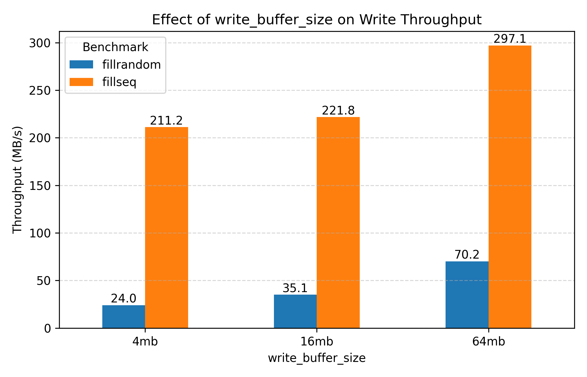
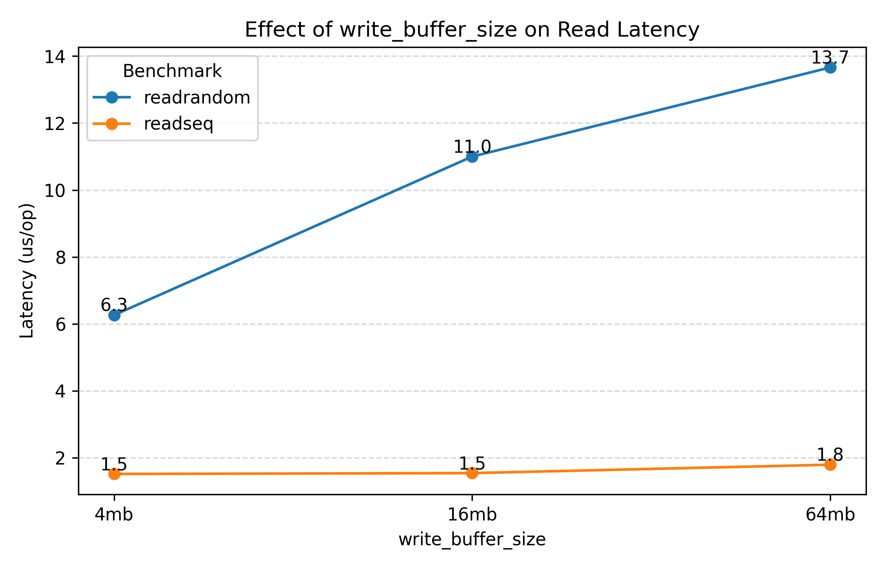
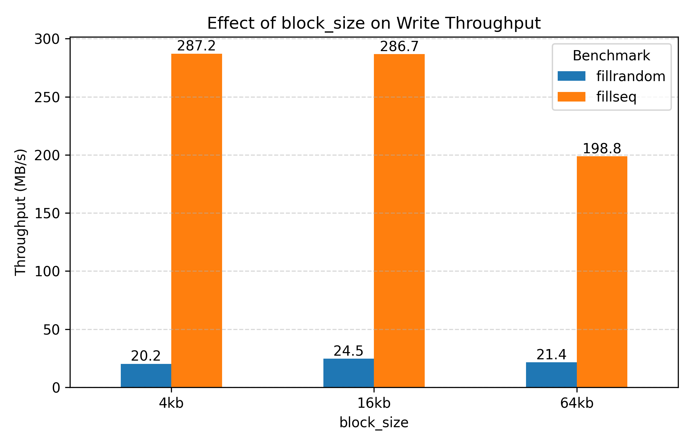
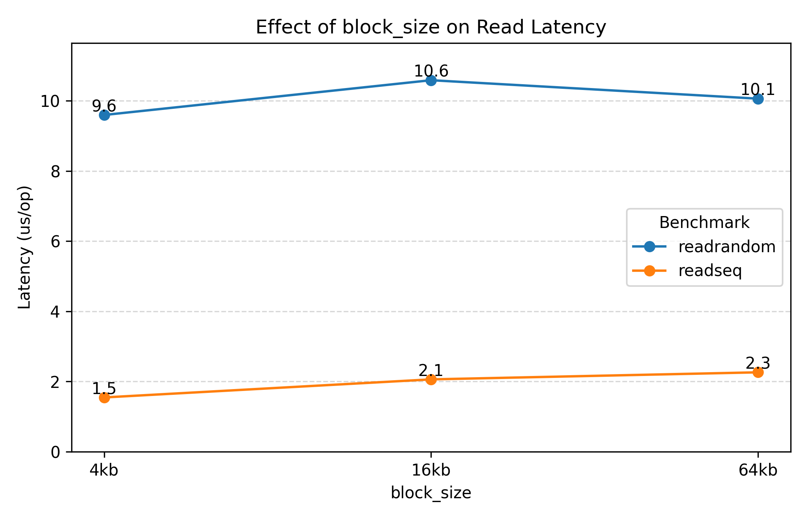
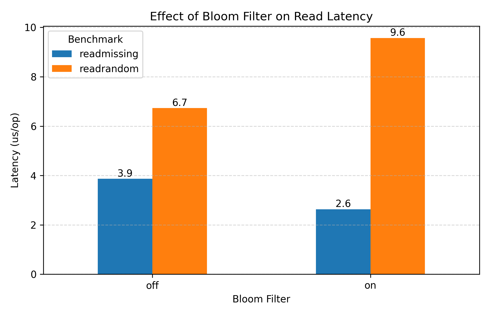
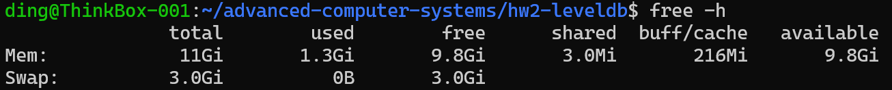
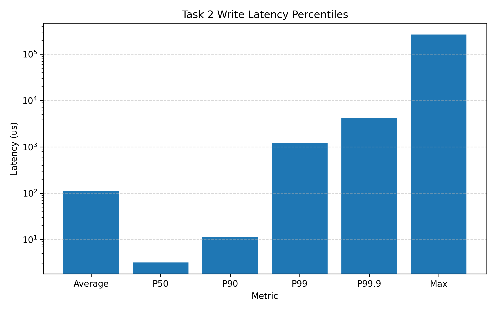
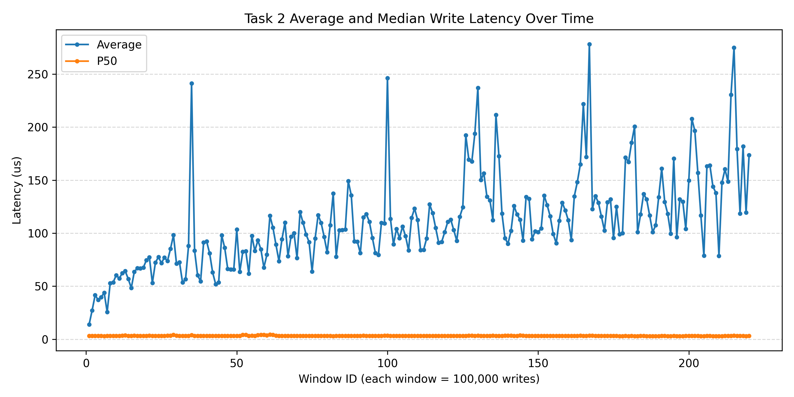
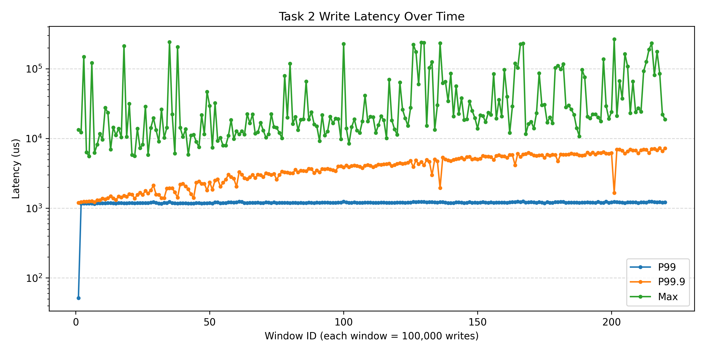
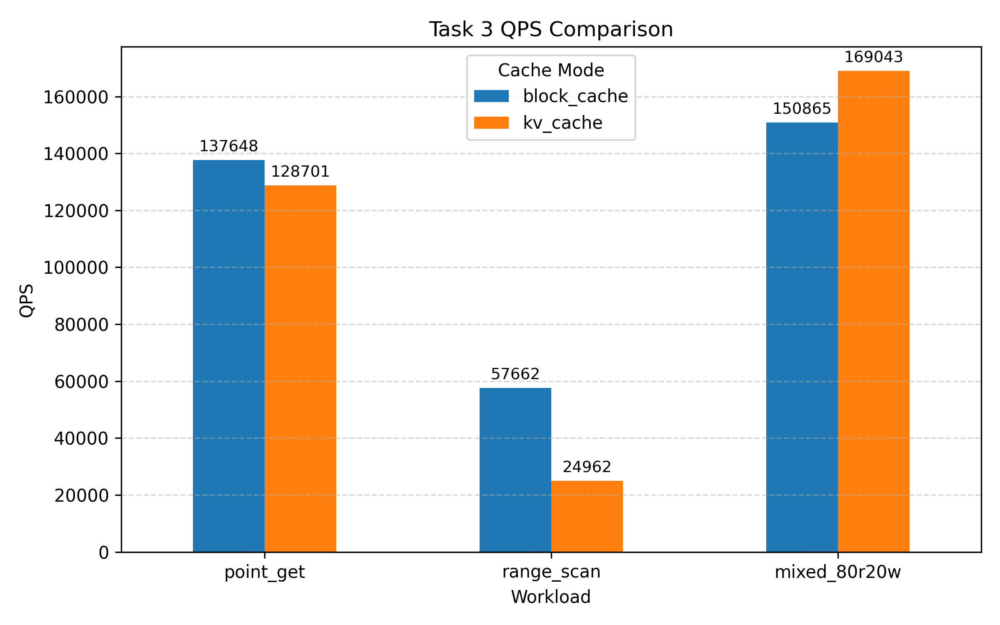

# 任务一：LevelDB 核心参数调优与性能对比

## 一、实验背景与系统理解

本实验围绕 LevelDB 的核心结构展开。LevelDB 是基于 LSM-Tree（Log-Structured Merge Tree）的数据库实现，其核心架构包括 MemTable 和 SSTable。前者是在内存中的存储结构，在 LevelDB 实现为一个跳表；后者则是磁盘上的存储结构，每个 SSTable 本质是一个有序、不可修改的磁盘文件，内部以 block 划分。

每次插入数据时，首先会写入 MemTable，这样可以避免频繁的磁盘 I/O。当 MemTable 达到一定容量后，它会被刷新到磁盘上，形成一个 SSTable 文件。为了减少磁盘空间的浪费，LevelDB 会定期对磁盘中的 SSTable 文件进行合并（Compaction）。合并操作会将多个小的 SSTable 文件合并成一个较大的文件，并清理掉过时的数据。

任务一涉及的三个参数的实际意义是：

- `write_buffer_size`：控制 MemTable 的大小，当写入数据到达此容量时，便会把 MemTable 的数据 flush 到磁盘的 SSTable。
- `block_size`：block 是 SSTable 内部最小的读写单位，每个 SSTable 由若干 block 组成，block 大小直接决定了读写操作的粒度。
- `Bloom Filter`：是一种用于快速判断某个 key 是否可能存在于某个 SSTable 中的概率型数据结构。当此结构启用时，LevelDB 会为每个 SSTable 构建 Bloom Filter，在查询时先通过它判断目标 key 是否可能在该文件中，如果判断一定不存在，则可以直接跳过该 SSTable，避免不必要的磁盘读取。


## 二、前期准备与测试脚本

在实验开始前，我首先完成了 LevelDB 源码的下载与编译，并通过官方自带的 `db_bench` 工具验证环境是否正常，实际运行后确认其可以稳定输出各类 benchmark 指标。后续实验的脚本内容便可以基于 `db_bench` 编写自动化脚本完成。

在进入实验主体前，为了尽量减少系统缓存干扰，我先编写了 drop_cache.sh，用以在每次测试前主动清理 Linux 的 Page Cache：

```
echo 3 | sudo tee /proc/sys/vm/drop_caches
```

在任务一的具体测试脚本中，我将不同类型的测试进行了拆分。对于写入性能，分别运行 `fillseq` 和 `fillrandom`，用于观察顺序写和随机写在不同参数配置下的变化。对于读取性能，则先使用 `fillrandom` 构建一个固定规模的数据库，随后在该数据库上通过 `--use_existing_db=1` 执行 `readrandom` 和 `readseq`，这样能避免读测试过程中重新建库对结果产生影响。

为了控制实验变量，脚本将每组参数封装为一个独立的实验组。每个实验组都会重新创建数据库目录，并在测试前调用 `drop_cache.sh` 清理系统 Page Cache，从而尽量减少操作系统缓存对测试结果的干扰。测试输出通过 `tee` 同时显示在终端并保存到 `data/task1_raw` 目录中，便于后续整理和分析。

> 首次测试后发现 Bloom Filter 参数实验的结果与预期不太匹配，因此额外增加了对 `readmissing` 的测试，专门验证其优化效果


## 三、实验结果与分析

### 1. write_buffer_size 对性能的影响

<figure>
    
    
</figure>

一方面，从左图可以看出，增大 `write_buffer_size` 后，LevelDB 的写入吞吐量有明显提升。其中随机写的提升最为显著，从 4MB 时的约 20MB/s 提升到 64MB 时的约 70MB/s；顺序写也从约 210MB/s 提升到接近 300MB/s，但是提升幅度不如随机写。说明**更大的 write buffer 能够有效改善写入性能，且对随机写的影响更显著**。

如前文所述，`write_buffer_size` 决定了单个 MemTable 能容纳的数据量。当该值较小时，MemTable 很快被写满，因此在写过程需要频繁 flush 到磁盘，产生大量较小的 SSTable 文件。这不仅增加了 flush 本身的开销，也会提高后续 compaction 的频率和压力。

在随机写场景下，key 的分布更加分散，频繁生成的小而乱的 SSTable 更容易带来额外的合并成本，因此性能受影响更明显。相比之下，顺序写本身具有更好的局部性，写入的数据在 key 空间上更连续，形成的 SSTable 范围也更规整，合并时成本相对较低。因此即使 buffer 较小，顺序写受到的影响也相对有限。

另一方面，从右图可以看出，读取延迟随着 `write_buffer_size` 增大反而上升，尤其是随机读延迟，从约 6us/op 增加到约 14us/op。这个结果说明**更大的 write buffer 并不有利于读性能**。原因可能在于，较大的 MemTable flush 后会形成更大的 SSTable 文件，单个文件覆盖的 key 范围更宽，读操作在定位目标 key 时可能需要处理更大的数据块索引或更复杂的文件查找路径。同时，较大的写缓冲也可能改变 compaction 后的数据布局，使得随机读的缓存命中率和局部性下降。

所以最终的结论十分有趣，`write_buffer_size` 体现了 LevelDB 中的**读写权衡**：增大该参数可以减少 flush 和 compaction 带来的写放大，从而显著提高写入吞吐量；但它也可能使磁盘上 SSTable 的组织方式发生变化，对读取延迟产生不利影响。在写密集型场景下，可以适当增大该参数；而在对读延迟（尤其是随机读）敏感的场景中，则需要结合实际 workload 选择更合适的大小。

------

### 2. block_size 对读性能的影响

<figure>
    
    
</figure>

整体来说，`block_size` 对性能的影响比较有限，增大 `block_size` 会在一定程度上恶化读性能，并且对写性能也没有带来明显、成趋势的收益。

在写性能方面，随机写在 16KB 时表现最好，4KB 和 64KB 相对较低；顺序写在 4KB 和 16KB 时基本接近，但 64KB 时出现明显下降。这说明适当增大 block 可以减少部分元数据和编码开销，但当 block 过大时，单个 block 的构建、压缩和写出成本也会增加，反而影响写入效率。

在读性能方面，整体趋势更明显：随着 `block_size` 增大，读延迟总体上升，尤其是顺序读从 4KB 到 64KB 持续变慢。原因在于 block 是 SSTable 的基本读取单位，block 越大，单次查询需要加载的数据越多，即使只访问其中少量 key，也会带来更大的读放大。同时，较大的 block 也会降低 Block Cache 中可容纳的 block 数量，影响缓存利用率。

综合来看，对于以 KV 查询为主的场景，选择 4KB 或 16KB 这类较小到中等的 block size 可能更为合适。

------

### 3. Bloom Filter 的作用分析



在实验前，原本预期 Bloom Filter 能够在一定程度上优化 `readrandom`，因为它可以减少不必要的 SSTable 访问。然而从结果来看，对于 `readrandom`（大部分是命中查询），开启 Bloom Filter 后延迟反而略有上升。这说明在命中场景下，Bloom Filter 基本无法减少实际的数据访问路径，只是额外引入了一次哈希计算和过滤器查询，因此反而带来了更多的性能开销。

相比之下，在 `readmissing` 场景中结果与预期一致。开启 Bloom Filter 后，延迟明显下降（约降低 30% 左右）。这说明 Bloom Filter 在查询不存在的 key 时能够有效发挥作用：通过快速判断 key 不存在于某些 SSTable 中，从而跳过这些文件，避免无效的 block 查找和磁盘访问。

Bloom Filter 并不能加速读，而只是避免无意义的读，只有 workload 中存在大量 miss 查询时，它的价值才能体现出来。


# 任务二：长尾延迟测量与 Compaction 现象观察

## 一、实验设计与实现

在任务二中，我不再使用 `db_bench` 作为主要工具，而是实现了一个自定义的写入压测程序，对每一次 `Put` 操作进行精细计时。这样做的主要原因是，本任务关注的不是平均性能，而是写入延迟的分布特征，尤其是尾部延迟，而这一点 `db_bench` 无法灵活提供。

测试程序的核心逻辑如下，本质上是在持续随机写入的同时记录每一次操作的耗时：

```cpp
auto start = Clock::now();
status = db->Put(write_options, key, value);
auto end = Clock::now();

double us = std::chrono::duration<double, std::micro>(end - start).count();
all_latencies.push_back(us);  // 全部数据集
window_latencies.push_back(us);  // 窗口数据集
```

在数据记录上，我做了两层统计。一方面对全部写操作进行汇总，计算平均值以及 P50、P90、P99、P99.9 等分位数；另一方面将写入过程按固定窗口划分（每 100,000 次写入为一个 window），在每个窗口内分别计算局部统计量，从而观察延迟随时间的变化趋势。

测试负载采用持续随机写入，value 大小固定为 1KB，总写入规模约 22GB，超过机器可用内存（约 9.8GB）的两倍，以确保数据无法完全驻留在内存中，从而触发实际的磁盘 I/O、MemTable flush 以及后台 compaction 行为。




## 二、LevelDB 长尾延迟的背景与机制

前面已经说过，LevelDB 基于 LSM-Tree 结构，写操作时数据首先进入 MemTable，属于内存级操作，因此大多数写入延迟较低且稳定。但随着系统运行，下面两个过程会拖慢写入：

第一是 MemTable flush。当写入数据到达 MemTable 阈值容量时，会把 MemTable 的数据 flush 到磁盘的 SSTable。这一过程涉及磁盘写入，自然会消耗一定 I/O 带宽。

第二是更关键的 compaction。当磁盘上的 SSTable 文件数量逐渐增多时，LevelDB 需要在后台执行合并操作，将多个文件重新整理为更少、更有序的 SSTable，同时清理过期数据。这一过程不仅涉及大量磁盘读写，还会占用 CPU 资源。

由于前台写入与后台 flush / compaction 共享系统资源，最终导致在 compaction 触发的时刻，部分写请求会被大幅延迟（出现“写毛刺”的现象）。当然，这种现象不会影响所有请求，而是只作用于少数正好与后台 I/O 冲突的操作，因此表现为长尾延迟分布（也就是大部分延迟低，极少部分延迟很高，带动整体平均延迟上升的分布）。


## 三、实验结果与分析

### 1. 整体延迟分布



从整体分布可以看出，写入延迟呈现出明显的长尾特征。P50 仅为几微秒，P90 也仍处于较低水平，说明绝大多数写操作仅经过 MemTable，仍属于内存级开销。而从 P99 开始，延迟迅速跃升到毫秒级，P99.9 和最大值进一步拉大，最大延迟甚至达到数百毫秒。

这表明系统的典型常规路径其实非常快，但存在极少数请求会经历明显更长的执行路径。这些请求往往与磁盘 I/O 或后台操作相关，因此延迟远高于普通写入。也正因为这些少量极慢请求的存在，使得平均延迟远高于中位数，体现出典型的长尾分布。

------

### 2. 平均值与中位数对比



从时间维度看，P50 基本保持稳定，而 Average 则呈现缓慢上升并伴随波动。两者的分离说明：系统的大多数请求路径没有发生明显变化，性能退化主要来自少量高延迟请求。

进一步观察可以发现，每当出现延迟尖峰时，Average 会被明显拉高，而 P50 几乎不受影响。这说明平均值对尾部异常非常敏感，容易被少数慢请求主导。因此，仅使用平均延迟来评估系统性能是有偏的，必须结合分位数指标才能准确反映真实情况。

------

### 3. 尾延迟随时间变化



从整体趋势来看，P99 曲线始终较为平稳，而 P99.9 和 Max 则呈现出明显的波动上升趋势。由此可见，即使在 P99 这个已经较高的分位点上，系统仍然保持稳定，说明绝大多数（99%）写请求都并不会受到后台操作的显著影响。换句话说，flush 和 compaction 对写路径的干扰具有很强的“局部性”，只作用于极少数请求，而往往不会过多地系统性拖慢整体性能。

相比之下，P99.9 和 Max 的剧烈波动说明，真正受到影响的是最最尾部的一小部分请求。这些请求往往正好与后台 I/O 或 compaction 发生竞争，从而被放大为明显的延迟尖峰。

从时间维度进一步观察，可以将过程大致分为前后两个阶段：

在前半段，P99.9 虽然已有波动，但整体幅度相对可控；Max 则是偶尔出现较高尖峰，说明此时系统仍处于较轻负载阶段，SSTable 数量较少，compaction 触发频率不高，后台操作对前台写入的干扰是偶发的，虽然已经开始影响个别写请求，但影响范围还相对有限。

而进入后半段，P99.9 曲线整体抬高，同时 Max 的尖峰出现得更加频繁且密集，表明随着数据规模增长，SSTable 数量不断增加，compaction 从偶发事件逐渐变为持续存在的后台压力。此时写入更容易与后台 I/O 冲突，从而导致尾延迟不仅更高，而且出现得更频繁。


# 任务三：应用层 KV Cache 与底层 Block Cache 的设计与对比  

## 一、实验目标与背景

任务三主要比较两种不同粒度的缓存机制：LevelDB 内部的 Block Cache，以及我自己实现的应用层 KV Cache。

LevelDB 的 Block Cache 缓存的是 SSTable 中的数据块。一个 block 通常包含一段连续的 key-value 数据，因此它更适合范围查询、顺序扫描这类具有局部性的访问模式。应用层 KV Cache 则直接缓存单个 key 对应的 value，粒度更细，更适合热点点查场景。

因此这个实验的核心不是单纯判断“哪种缓存一定更快”，而是观察不同访问模式下缓存粒度带来的差异。


## 二、代码实现思路

### 1. LRU KV Cache 实现

我实现的 KV Cache 使用的是经典的：

```
unordered_map + list
```

其中 `unordered_map` 用于根据 key 快速定位缓存项，`list` 用于维护 LRU 顺序。每次命中缓存时，会把该节点移动到链表头部；当缓存容量超过限制时，则从链表尾部淘汰最久未使用的数据。

核心逻辑大致如下：

```
bool LRUCache::Get(const std::string& key, std::string& value) {
    auto it = map_.find(key);

    if (it == map_.end()) {
        ++misses_;
        return false;
    }

    Touch(it->second);
    value = it->second->value;
    ++hits_;
    return true;
}
```

这里我保留了真实 value 拷贝，也就是说缓存命中时并不是只判断 key 是否存在，而是确实返回完整 value。这样更符合一个应用层 KV Cache 的真实语义，但也会带来一定开销，尤其本实验 value 大小设置为 1KB。

------

### 2. Zipf 访问生成器

为了模拟热点访问，我实现了 Zipf 分布生成器。它会让少量 key 被频繁访问，而大量 key 很少访问，这更接近真实系统中的访问模式。

一开始我使用 `theta=0.99`，但实验发现热点程度不够明显，KV Cache 虽然有较高命中率，但在 point get 中仍不容易体现优势。后来我将参数调整为：

```
const double zipf_theta = 1.2;
```

这样热点更加集中，KV Cache 的命中率提升到 90% 以上，实验现象也更清楚。

另外，由于 LevelDB 的 key 是按顺序组织的，如果 Zipf 热点集中在小编号 key 上，热点可能集中落在少数 SSTable block 中，这会让 Block Cache 也获得额外优势。因此我对 Zipf 生成的 rank 做了一个确定性映射：

```
static uint64_t PermuteKey(uint64_t x, uint64_t n) {
    const uint64_t A = 11400714819323198485ull;
    return (x * A) % n;
}
```

这样可以把热点 key 打散到整个 key 空间中，使 point get 更能体现 KV 粒度缓存的特点。

------

### 3. 两种缓存模式

实验程序支持两种运行模式。

在 `block_cache` 模式下，我开启 LevelDB 内部 Block Cache，不使用自定义 KV Cache。读操作直接调用 LevelDB 的 `Get` 或 Iterator 接口：

```
leveldb::Status s = db->Get(read_options, key, &value);
```

在 `kv_cache` 模式下，我关闭 LevelDB 内部 Block Cache，并使用自己实现的 LRU KV Cache 作为前置缓存。读请求会先查 KV Cache，未命中时再查 LevelDB，并将结果写回 KV Cache：

```
if (!kv_cache.Get(key, value)) {
    leveldb::Status s = db->Get(read_options, key, &value);
    if (s.ok()) {
        kv_cache.Put(key, value);
    }
}
```

为了尽量保证对比公平，我后来对脚本做了一次重要调整：不再让 `block_cache` 模式负责建库，而是新增 `build_only` 阶段。最终流程变成：

```
build_only 单独建库
drop_cache
block_cache 测试
drop_cache
kv_cache 测试
```

这样避免了 Block Cache 模式在刚建完数据库、Page Cache 仍然较热的情况下直接测试。

------

### 4. 三类 workload

本实验围绕三类典型访问模式展开，并在同一套测试框架下分别实现，以尽量贴近真实系统中的访问行为。

`point_get` 对应高频随机点查，是最基础的 KV 查询模式。在实现上，每次操作通过 Zipf 分布生成一个 key（并经过一次扰动映射打散分布），然后执行单次查询。在 Block Cache 模式下直接调用：

```
db->Get(read_options, key, &value);
```

而在 KV Cache 模式下，则先查应用层缓存：

```
if (!kv_cache.Get(key, value)) {
    db->Get(read_options, key, &value);
    kv_cache.Put(key, value);
}
```

这个 workload 的重点在于放大“热点 key 被重复访问”的现象，用来观察细粒度缓存（KV）是否能更直接地命中热点。

------

`range_scan` 对应范围查询，是另一类常见但访问特征完全不同的场景。在实现上，我统一定义为：从某个起始 key 出发，连续读取固定长度（如 100 个）的 key。

在 Block Cache 模式下，我使用 LevelDB 提供的 Iterator 顺序遍历：

```
Iterator* it = db->NewIterator(read_options);
it->Seek(start_key);
for (int i = 0; i < scan_length && it->Valid(); ++i, it->Next()) {
    // consume value
}
```

而在 KV Cache 模式下，我使用等价的逻辑，只是将每个 key 显式取出：

```
for (int i = 0; i < scan_length; ++i) {
    std::string key = GenKey(start + i);
    if (!kv_cache.Get(key, value)) {
        db->Get(read_options, key, &value);
        kv_cache.Put(key, value);
    }
}
```

这里看起来两种模式调用路径不同，但本质上两者都在做“连续 key 的访问”。区别主要来自底层实现方式：Iterator 在 LevelDB 内部可以顺序扫描 SSTable block，而 KV Cache 模式是逐 key 查询。Block Cache 以 block 为单位复用数据，而 KV Cache 只能按 key 复用，如果编程的时候刻意统一形式，那么实质上 KV Cache 模式的设置就失去意义了。

------

`mixed_80r20w` 用于模拟更接近实际系统的混合负载，其中读操作占 80%，写操作占 20%。在实现上，每次操作先随机决定类型：

```
if (rand() % 10 < 8) {
    // read
} else {
    // write
}
```

读路径与 `point_get` 相同，仍然基于 Zipf 分布生成 key；写路径则执行：

```
db->Put(write_options, key, value);
kv_cache.Put(key, value);
```

这里我选择在写入后同步更新 KV Cache，而不是简单失效或忽略。这一设计是为了保证缓存中始终保留最新数据，同时也更接近实际系统中 write-through cache 的行为。


## 三、实验结果与分析



在 `point_get` 场景下，Block Cache 的 QPS（约 137k）略高于 KV Cache（约 128k），这一结果略微偏离最初“KV Cache 更适合点查”的直觉预期。结合实现可以解释：虽然 KV Cache 命中率较高，但每次命中都涉及 value（1KB）的拷贝以及 LRU 结构维护（链表移动），这些操作本身存在非忽略开销；而 Block Cache 命中后，LevelDB 可以直接在 block 内完成查找，避免了额外的数据结构操作。因此在当前实现下，KV Cache 的细粒度优势被实现开销部分抵消，导致未能完全体现理论优势。

在 `range_scan` 场景中，Block Cache 表现明显优于 KV Cache（约 57k vs 25k QPS）。这一结果符合预期。范围查询具有很强的顺序局部性，Iterator 可以顺序扫描 SSTable，并在 block 内复用数据；而 KV Cache 只能逐 key 查询，即使命中也无法利用“连续数据”的结构优势，反而引入额外查找和维护成本。因此在该场景下，block 粒度缓存对顺序访问更友好。

在 `mixed_80r20w` 场景中，KV Cache 的 QPS（约 169k）高于 Block Cache（约 150k）。这一结果说明在混合负载下，热点点查仍然占主导，使 KV Cache 能够发挥优势。同时，写操作通过 write-through 同步更新缓存，使热点数据能够持续留在缓存中，从而进一步提高命中率。而 Block Cache 虽然也能受益于读操作，但由于访问模式不完全连续，其优势不如 range scan 场景明显。

> ### **附录：AI 使用情况**
>
> **本次作业中，在基础知识预备、查找资料，以及可视化相关脚本和Makefile、REAME的编写中借助了AI工具**

